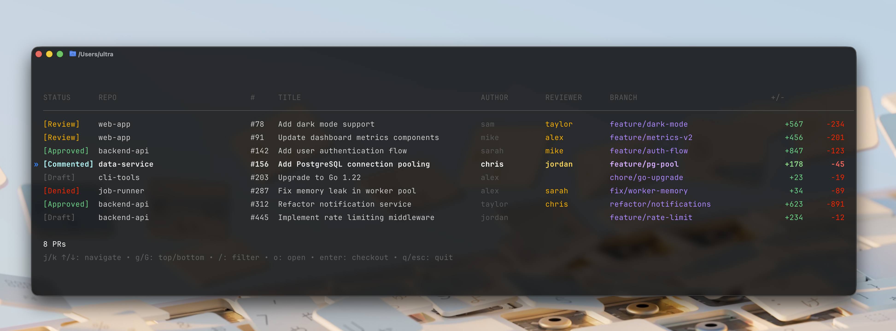

<picture>
  <source media="(prefers-color-scheme: dark)" srcset="sup-negative.svg">
  
</picture>

[](https://go.dev)
[](https://github.com/superultrainc/sup/releases)
[](LICENSE)

A terminal UI for browsing and checking out GitHub PRs.

<picture>
  <source media="(prefers-color-scheme: dark)" srcset="screenshot-dark.png">
  
</picture>

## Requirements

- [gh](https://cli.github.com/) CLI (authenticated via `gh auth login`). sup reads its token and talks to the GitHub API directly; `gh` itself only runs for checkout and merges into repos that use a merge queue.

## Install

```bash
curl -sSL https://raw.githubusercontent.com/superultrainc/sup/main/install.sh | bash
```

Or with Go (requires manual shell setup):
```bash
go install github.com/superultrainc/sup@latest
```

If using `go install`, add this to your `~/.zshrc` or `~/.bashrc` for auto-cd after checkout:
```bash
sup() {
  rm -f /tmp/sup-selection
  command sup "$@"
  if [[ -f /tmp/sup-selection ]]; then
    cd "$(cat /tmp/sup-selection)"
    rm -f /tmp/sup-selection
  fi
}
```

## Usage

```bash
sup          # Show PRs from your GitHub organizations (auto-detected)
sup --mine   # Show PRs you're involved in (authored, reviewing, mentioned)
sup 42                                   # Open PR #42 of the repo you're in
sup acme/web#42                          # Open a PR by owner/repo#number
sup web 42                               # Repo name or unique part of it (from listed PRs)
sup https://github.com/acme/web/pull/42  # Open a PR by URL
```

Tab completion (zsh) suggests PRs from the last listing; `sup web <tab>` lists just that repo's PRs. `install.sh` sets it up; otherwise add this to `~/.zshrc` after `compinit`:
```bash
source <(sup --zsh-completion)
```

**Zero config required** - sup automatically detects your GitHub organizations.

Select a PR and press Enter to open it. To check it out locally, pick "Checkout PR" from the `ctrl+k` palette.

PRs are listed most recently updated first, with drafts at the bottom.

### Filtering

Repo, author/reviewer, status, and free text combine — each one narrows the list further.

- `p` / `P` steps through the repos present in the loaded PRs; the cycle passes through an unfiltered position to clear it.
- `#name` in the filter box (`/`) matches a repo exactly.
- `Esc` clears every active filter at once.

## Keybindings

| Key | Action |
|-----|--------|
| `j` / `↓` | Move down |
| `k` / `↑` | Move up |
| `g` | Go to top |
| `G` | Go to bottom |
| `space` | Preview pane: the list narrows to the left and the selected PR's Conversation tab shows on the right. `ctrl+d` / `ctrl+u` or the mouse wheel scroll it, clicking it opens the full PR view. Needs a terminal at least 100 columns wide |
| `/` | Filter PRs (prefix `#` repo, `@` reviewer, `!` author) |
| `s` / `S` | Cycle status filter (forward / back) |
| `p` / `P` | Cycle repo filter (forward / back) |
| `a` | Filter to your PRs |
| `r` | Filter to your review requests |
| `o` | Open PR in browser |
| `O` | Open all PRs needing review in browser |
| `c` | Copy PR link to clipboard |
| `v` | Full PR view: conversation (description, checks, reviews, comments) and a syntax-highlighted diff with review threads inline |
| `d` | Open the PR view on its diff (Files changed tab) |
| `m` | Merge PR: pick squash / merge commit / rebase, delete the branch, or enable auto-merge |
| `A` | Approve PR (with `y`/`n` confirm) |
| `D` | Request changes — opens `$EDITOR` for body |
| `M` | Comment on PR — opens `$EDITOR` for body |
| `W` | Convert PR to a draft, or mark a draft ready for review (with `y`/`n` confirm) |
| `X` | Close PR (with `y`/`n` confirm) |
| `?` | Toggle full help overlay |
| `ctrl+k` | Command palette: type to find any action, `enter` runs it (works in the PR view too) |
| `q` / `Esc` | Quit |

Terminals don't pass `Cmd` to TUI apps, so to use `Cmd+K` map it to `ctrl+k` in your terminal. Ghostty: `keybind = cmd+k=text:\x0b`. kitty: `map cmd+k send_text all \x0b`.

### PR view

`v` opens a full-screen view of the selected PR, laid out like GitHub's PR page. `tab` / `shift+tab` or `1`–`4` switch tabs:

- **Conversation**: the description, then a timeline of comments, reviews, pushed commits, and review threads (resolved ones folded), ending with a merge box (review, checks, conflicts). Reviewers, assignees, and labels sit in a sidebar on wide terminals.
- **Files changed**: syntax-highlighted diff with word-level change highlights and review threads inline under their lines, plus a file tree on wide terminals. Lockfiles and very large diffs start collapsed.
- **Commits**: commits grouped by day.
- **Checks**: every check on the latest commit, failures first.

| Key | Action |
|-----|--------|
| `j` / `k`, `ctrl+d` / `ctrl+u`, `space` | Scroll |
| `/` | Search the current tab (`enter` keeps it, `esc` cancels or clears) |
| `[` / `]` | Previous / next item (Conversation, Commits) or file (Files) |
| `n` / `N` | Next / previous search match; without a search, next / previous review thread (Files) |
| `s` | Cycle layout: auto → split → unified |
| `w` | Toggle line wrapping |
| `x` | Collapse / expand the current file |
| `r` | Request or remove reviewers (type to filter, `space` toggles, `enter` saves) |
| `m` | Merge (`↑`/`↓` method, `b` delete branch, `a` auto-merge, `!` admin bypass when allowed) |
| `d` | Jump to Files changed |
| `R` | Reload |
| `esc` | Back to the list |

`A`, `D`, `M`, `W`, `X`, `o`, and `c` work from here too.

The mouse works too: click a tab to switch, click a file in the tree to jump to it, and scroll with the wheel. In the list, click a PR to select it and click it again to open it. Hold Option (or Shift, depending on your terminal) to select text.

Images in descriptions and comments render inline. Terminals with the kitty graphics protocol and Unicode placeholders (kitty, Ghostty, Rex) get full-resolution images; others get a truecolor half-block preview. Detection is automatic; set `SUP_IMAGES=kitty` or `SUP_IMAGES=blocks` to force one.

PRs open instantly once cached. In the background, sup warms every listed PR (nearest the cursor first), keeps a disk cache in `~/.cache/sup/prs`, and refreshes what's open. A PR is only refetched when its `updatedAt` changes, and its diff only when the head commit does.

## Configuration (optional)

| Variable | Description | Default |
|----------|-------------|---------|
| `SUP_ORG` | Override org detection (comma-separated) | auto-detected |
| `SUP_DEV_DIR` | Override repo location search | auto-detected |
| `SUP_IMAGES` | Image rendering: `kitty` or `blocks` | auto-detected |

Repos are automatically found in: `~/Development`, `~/dev`, `~/projects`, `~/code`, `~/src`, `~/repos`, `~/github`, `~/git`, `~`
